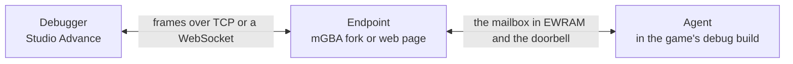

# Debug link

The debug link connects a debugger (Studio Advance's) to a game running in an emulator or a browser: pause and step, breakpoints in scripts, the call stack and variables, an entity inspector, memory viewers, a profiler, logs and hot reload of scripts. It is a contract between three parties, the engine, the endpoint the game runs in (the debugger's mGBA fork, or the game's web page) and the debugger, so it is specified here, in the open repository. The debugger's own work (maps from bytecode to source, planning breakpoints, steps and reloads, the event editor's blocks) is the editor's.

**Status:** **protocol 1.0, mailbox v1** (decided 2026-10-10; [open-questions.md](open-questions.md)), being implemented step by step ([Implementation](#implementation)), each step an addition in a 1.x minor version ([api-freeze.md](api-freeze.md#later-additively-no-api-now)). **Implemented** (2026-10-10): the [maps](#maps) (E3, E4); the agent's core (E5: `src/core/link.c`, its VM part `src/core/vm_link.c`: the mailbox, framing, `AGENT_INFO`, `PAUSE`, `RESUME` and a frame step, `GLOBALS`, `SET_GLOBAL`, `ARRAY_CELLS`, `SET_ARRAY_CELL`, `ENTITIES`, `ENTITY`, `SET_PROPERTY`, `STATS_SUBSCRIBE` and `STATS`, `OPTIONS`, `LOADED`, the error codes); the platforms' ends (E7: the GBA's registers, `src/gba/link_gba.c`, tested only as far as dormancy and the host tests reach, since no fork exists yet; the web page's, `src/web/link.js` and `link_web.c`, tested end to end); and `tools/svlink.py`, the reference client (E8; CTest `svlink_e2e`); and (2026-10-11) the VM's part (E6: `src/core/vm_link.c` and a few hooks in `vm.c`: `BRK` parking and displaced execution, breakpoints, stepping, `CONTEXTS`, `FRAMES`, `SET_LOCAL`, faults and stop on fault, `debug_break()` in C and as a Lua builtin, `STATS`' VM cycles and queue peak, `LOADED` from the loader; [as built](#the-vms-part-as-built)); and (2026-10-11) hot reload (E9: `src/core/link_reload.c` and `vm.c`'s `serval_vm_link_reload()`: `RELOAD_BEGIN` to `RELOAD_COMMIT` and `RELOADED`, plans that keep unchanged behaviours at their new offsets, restart changed ones and carry state by name, a "halt instead" action; `serval_add_script()`'s `KEEP_LAYOUT`; `tools/svlink.py reload`; [as built](#hot-reload-as-built)). **Still to come:** the mGBA fork (F1). Release builds contain none of it.

## Architecture

| Part | What it is | What it does | Ships with |
| --- | --- | --- | --- |
| **Agent** | Engine code in debug builds: `src/core/link.c` (portable, host-tested), the VM's part in `src/core/vm_link.c`, reached through a table `vm.c` defines (so a game without scripts doesn't link it), the platform's end in `src/gba/link_gba.c`, `src/web/link_web.c` | Answers in the VM's and the ECS's vocabulary (contexts, frames, cells, globals, arrays, entities, `VM_P_*` properties), parks the game, patches breakpoints, applies reload plans, sends stats | The engine (MIT) |
| **Endpoint** | The transport at the game's end: the mGBA fork's process, or the web page's script | Carries frames between the debugger and the mailbox; answers raw memory, machine pause and logs itself | The fork with the debugger (MPL 2.0); the page with the engine (`src/web/shell.html`, MIT) |
| **Debugger** | The host | Everything source-level: the maps, breakpoint and step planning, reload planning, the UI | Studio Advance (closed) |

**Two contracts**, both specified here:

| Contract | Between | Versioned by | Sections |
| --- | --- | --- | --- |
| The **link protocol**: frames and messages | The debugger and the game: the endpoint answers its own messages, the agent the rest | The protocol version, `major.minor`, in `HELLO` (the endpoint's) and `AGENT_INFO` (the agent's) | [Framing](#framing) to [Messages](#messages-protocol-10) |
| The **mailbox**: a RAM layout, two registers and a doorbell | The endpoint and the agent | The mailbox version, in its header | [The game side](#the-game-side) |

**Who owns which messages.** Types 0x00-0x3F are the endpoint's: it answers them itself, without the agent, so they work in release builds and in games from before the agent. Types 0x40-0xFF are the agent's: the endpoint copies them between the debugger and the mailbox both ways without reading them, so a new agent message never needs a new fork. The fork ships with the debugger, not with the engine, so it must serve the mailbox of every engine a project can pin: the mailbox is small and versioned for that.

**Why an agent, and not the debugger reading RAM.** The VM's contexts, frames and bindings are internal structs (`vm.c`'s context already differs from [vm.md](vm.md#contexts)'s sketch). A debugger decoding RAM would track every engine version's layout, for every version a project can pin. The agent answers in a vocabulary 1.0 already freezes (pcs as blob offsets, `VM_P_*` numbers, cells, entity handles), so the protocol outlives engine versions, and works the same in an emulator, on the web and, later, on hardware. Raw memory reads stay for what has fixed addresses: VRAM, palette RAM, OAM and the I/O registers. The engine exports no symbol table.

**What serves each feature:**

| Feature | Messages |
| --- | --- |
| Logs | `LOG` (the endpoint's; every build) |
| Pause, resume, step a frame | `PAUSE`, `RESUME`, `STOPPED` |
| Breakpoints, stepping, script breakpoints | `BREAK_SET`, `BREAK_CLEAR`, `STEP`, `STOPPED`; `BRK`, `debug_break()`; the [maps](#maps) |
| Call stack and locals | `CONTEXTS`, `FRAMES`, `SET_LOCAL`, named from the `.svdbg` map |
| Globals and arrays | `GLOBALS`, `ARRAY_CELLS`, `SET_GLOBAL`, `SET_ARRAY_CELL` |
| Entity inspector, live editing | `ENTITIES`, `ENTITY`, `SET_PROPERTY` (C games too) |
| Viewers: VRAM, palettes, OAM, affine matrices, raster effects | `READ_MEM` at the hardware's fixed addresses |
| Profiler | `STATS` |
| Faults | `FAULT`, and stop on fault (`OPTIONS`) |
| Hot reload | `RELOAD_*`, `RELOADED` |

## Transports

| Transport | Endpoint | Who dials | When |
| --- | --- | --- | --- |
| **mGBA fork** | The fork's process (`serval-emu`): a socket, the mailbox through mGBA's memory API, a hook for the two [registers](#finding-the-endpoint), mGBA's log forwarded as `LOG` | The fork dials the debugger, which listens on 127.0.0.1 only: `serval-emu --link 127.0.0.1:PORT --link-token TOKEN game.gba` | 1.x, after the web |
| **Web page** | The page's script (`src/web/link.js`, which `cmake/ServalWeb.cmake` adds to the pages built with the agent beside `src/web/shell.html`'s own), only in builds with the agent and only when the page's URL fragment holds `serval-link=TOKEN` (beside the test mode's `frames=...`) | The page dials `ws://<the host and port that served it>/serval-link` | 1.x, first: it needs no fork |
| **Real hardware** | Out of scope. Later it could be the same agent with a serial driver (the link port in UART mode to a USB adapter, about 11 KB/s) and the debugger as the host | — | Not planned. It would claim the serial port and its interrupt, so it would be a build option a game opts into, and needs no reservation now |

Both ends of the TCP connection disable Nagle's algorithm (`TCP_NODELAY`): requests and replies are small, and a round trip took 41 ms with Nagle against delayed ACKs, under 0.1 ms without.

**The fork** is a public fork of `mgba-emu/mgba` (MPL 2.0, which wants the modified files published), on a branch based on mGBA's master or a later release, not 0.10.x, which vendors `blip_buf` under the LGPL. It adds new files for the endpoint and an SDL frontend, `serval-emu`, and a small hook beside mGBA's debug registers for the two registers below; it keeps mGBA's GDB stub for debugging C at the ARM level. It lives outside this repository: the engine never depends on an emulator.

**Why not stock mGBA's GDB stub** (no fork; memory reads and writes, interrupts, watchpoints): measured with libmgba 0.10.5, a continued stub runs the core one instruction at a time, about 750 frames a second against 10,000 free-running, and one write watchpoint (the natural doorbell) drops it to about 20 frames a second, a third of real time; mGBA's snap package can't open the port at all. **Why not HTTP polling on the web:** a WebSocket pushes `STOPPED` and `LOG` the moment they happen.

## The game side

### What debug builds add

Debug builds are those with `SERVAL_DEBUG`: Debug and RelWithDebInfo, the builds a debugger runs. The agent is in every one, unless the CMake option `SERVAL_LINK` (1.x; default on) turns it off:

| Piece | Where | Cost with no debugger attached |
| --- | --- | --- |
| The agent: framing, the queries, parking, breakpoints, reload, stats | `src/core/link.c`; the VM's part in `src/core/vm_link.c`, reached only through `serval_link_vm`, a table `vm.c` defines and `link.c` refers to weakly, so a game without scripts doesn't link it; the entity properties' part only once `entity_create()` ran, so a game without entities keeps no pool through it | ROM only. Measured (E5, E7; RelWithDebInfo, Thumb): 5.4 KB in `hello`, 7.5 KB in `fireflies` and `jukebox`; at -O0 (Debug) 6.0 and 9.0 KB. The VM's part (E6) adds 0.5 KB in `hello` (the core's share: parking inside a frame, `debug_break()`) and 7.4 KB in `fireflies` and `jukebox` (5.4 KB in `vm_link.c`, 2.0 KB of hooks and accessors in `vm.c`); at -O0 0.5 and 13.4 KB. Hot reload (E9) adds 0.3 KB in `hello` and 5.3 KB in `fireflies` and `jukebox` (`link_reload.c`, and `serval_vm_link_reload()` in `vm.c`); at -O0 0.3 and 7.6 KB |
| The [mailbox](#mailbox-v1) | EWRAM | 3,092 bytes, and 44 of the agent's own |
| The scratch: the agent's copy of the blob, which breakpoints patch and reloads land in | EWRAM, `SERVAL_LINK_SCRATCH` bytes (a CMake cache variable; default 32,768; 0: no breakpoints, stepping or reload), in games that link the VM. Breakpoints and steps patch it (E6); a reload's new blob, its plan and the commit's copies of the globals and the RAM arrays' pool (5 KB) go in it (E9), so blobs up to about 26 KB reload | That much |
| The hot reload's state (E9) | EWRAM: the reload under way, the outcomes for `RELOADED`, each thread's object | 140 bytes in games with scripts (4 in `hello`) |
| The breakpoint sites (E6) | EWRAM: each site's pc, original opcode and kinds | 8 bytes a site, 256 sites: 2,048 bytes, and 28 of the VM part's own (16 in `vm_link.c`, 12 in `vm.c`) |
| A poll at the end of `frame_end()`, after `frames++` | `if (serval_link_hook) serval_link_hook();`, the pattern of the map, raster and mixer hooks | A load and a compare a frame; the hook is set only when an endpoint answered. Measured: about 30 cycles a frame (the hook is in EWRAM), 0.01% of the frame (`gba_link_tests`) |
| `BRK` restructured for [displaced execution](#setting-breakpoints-patching-with-displaced-execution), and the VM's other hooks (E6) | `vm.c` | Measured (`scriptmark`, RelWithDebInfo, the agent dormant): +1.9% of VM time (`fireflies` +1.5%): +1.45% an op, from code layout around `BRK`'s case, and 62 cycles a frame for the hooks' checks ([vm.md](vm.md#what-breakpoints-cost)) |
| IWRAM | — | **None** (CTests `link_map_hello` and `link_map_fireflies` check the maps) |

On the web, a debug page grows by 8 KB of WebAssembly (`hello`) to 14 KB (`fireflies`, `jukebox`): the agent, and Asyncify's instrumentation of the path to its park, which makes calls through pointers; with the page's script, `link.js`, the page grows by 16 to 22 KB. The VM's part (E6) adds 13.7 KB to the debug pages of games with scripts (`fireflies`, `jukebox`): its code, and Asyncify's instrumentation of the interpreter, which a park inside it unwinds through; about 60 bytes to the others. Hot reload (E9) adds 11.4 KB to those pages, 0.2 KB to the others; it changes no frame's cost (the benchmark's debug and release numbers are the same as before it), and release ROMs and pages stay byte for byte as they were. It costs no measurable speed: `fireflies`' debug page ran 6,000 frames in headless Chrome in 8.9 s before and after. A release page is unchanged, byte for byte.

**Release builds add nothing:** no agent, no mailbox, no hook, no register written. `BRK` stays a no-op and `TRACE` skips its operand, as today, and `debug_break()` does nothing. `debug_log()` still writes mGBA's debug registers in every build, which the fork forwards as `LOG`, so logs work in release builds too.

### Finding the endpoint

On the GBA, two registers in a range real hardware ignores, next to mGBA's debug registers (0x04FFF600-0x04FFF780), reserved for the debug link since 1.0 ([core-api.md](core-api.md#hardware-the-engine-uses)):

| Address | Size | Register | The agent writes | The endpoint |
| --- | --- | --- | --- | --- |
| 0x04FFF800 | 2 | Presence | `0x5E41`, once, in `serval_init()` | Reads back `0x1A5E` |
| 0x04FFF802 | 2 | Reserved | Nothing | |
| 0x04FFF804 | 4 | Doorbell | The mailbox's address, at every ring | Handles the ring during the write ([below](#the-doorbell)) |
| 0x04FFF808 | 8 | Reserved | Nothing | |

1. In `serval_init()`, the agent writes `0x5E41` to the presence register and reads it back. The fork answers `0x1A5E`; hardware and other emulators don't, and the agent stays dormant for the whole run: no hook, nothing else written. (mGBA's debug log uses the same handshake, `0xC0DE` answered by `0x1DEA` at 0x04FFF780.)
2. It fills in the mailbox's header and rings: the endpoint learns where the mailbox is, checks its magic and version, and writes `'SVLE'` into its `endpoint` field while a debugger is connected.
3. It sets its frame hook.

A read of open bus that happens to give `0x1A5E` can't park a game on hardware: the agent parks only while the mailbox holds `'SVLE'`, which only an endpoint writes, and only once a debugger has attached ([Handshake](#handshake)).

**On the web** there are no registers. When the fragment asks and the build has the agent, the page's script (`src/web/link.js`) calls the module's exported `serval_link_attach()` before the game starts (it returns the engine's version, for `HELLO`) and opens its WebSocket; `serval_init()` then starts the agent as on the GBA (a page that attaches later starts it at once). The agent rings through the doorbell import the page provides (`Module.servalLinkRing(address)`), and the page reads and writes the mailbox in the module's memory. A release page has none of this script, and a page opened without the fragment never attaches: its agent stays dormant.

### Mailbox v1

In EWRAM, 4-byte aligned, little-endian like the blob:

| Offset | Size | Field | Written by | Meaning |
| --- | --- | --- | --- | --- |
| 0 | 4 | magic | Agent | The bytes `SVLK` |
| 4 | 2 | version | Agent | 1 |
| 6 | 2 | size | Agent | The mailbox's size in bytes: 3,092 in v1 |
| 8 | 4 | endpoint | Endpoint | The bytes `SVLE` while a debugger is connected, 0 otherwise |
| 12 | 2 | in_len | Both | Bytes of frames in `in`. The endpoint writes frames into `in` and then `in_len`, only while it is 0 (later frames wait at the endpoint); the agent zeroes it once it has read them all |
| 14 | 2 | out_len | Both | Bytes of frames in `out`. The agent appends frames and adds their length, then rings; the endpoint sends them and zeroes it during the ring |
| 16 | 1 | state | Agent | 0 running, 1 parked at a frame boundary, 2 parked inside a frame (a `BRK`, a breakpoint, a step, `debug_break()`, a fault). Written before every ring |
| 17 | 3 | reserved | | 0 |
| 20 | 1,024 | in | Endpoint | Whole frames for the agent |
| 1,044 | 2,048 | out | Agent | Whole frames from the agent |

The agent rings after appending to `out` and before a frame that might not fit (it keeps room for a whole frame, 1,024 bytes). When it starts (`serval_init()`), the agent zeroes the whole mailbox, `endpoint` included, before writing its header: an endpoint that finds its `SVLE` gone at a ring while its debugger is connected knows the agent started again, sends `GAME_RESET` (if it had sent `AGENT_FOUND`), then `AGENT_FOUND`, and writes `SVLE` again. A later mailbox version only appends fields, after `out`, which an endpoint finds by `size` and ignores if it doesn't know them; a change to an existing field is a new major of the mailbox, which comes only with an engine major ([Versioning](#versioning-and-capabilities)).

### The doorbell

A ring is synchronous. During the write (in the fork's register hook, or the web's import call) the endpoint sends `out`'s frames, zeroes `out_len`, and reads `state`:

`state` says what the agent does after the ring. A ring that only makes room in `out` while the agent still reads `in` says running, even with the game parked, so an endpoint that pauses the machine for a parked agent never pauses it before the agent has emptied its inbox; the parked agent's ring before it waits says parked.

- **Running:** the write returns, and the game runs on.
- **Parked:** the fork pauses the emulated machine after the write. When a frame for the agent arrives, it writes `in` and runs the machine until the agent's next ring, so a parked game uses no host CPU, plays no sound and answers at once. The web page returns at once; the agent then [waits](#parking) for its inbox.

While the game runs, the agent reads `in` once a frame, in its hook at the end of `frame_end()`, so a running game's replies come at most a frame late.

### Parking

The agent parks the game at a frame boundary (the end of `frame_end()`) or inside a frame (in the interpreter, or in a C call of `debug_break()`), and the whole game stops there: other scripts, the C systems, the frame wait. Parking sets `state`, queues `STOPPED`, rings, then loops: it handles the inbox's frames and rings with the replies until a `RESUME` or a `STEP`, or until the debugger detaches.

| Endpoint | How the parked agent waits |
| --- | --- |
| The fork | It doesn't: the fork has paused the machine, and runs it only to deliver a request |
| The web page | `emscripten_sleep()`: the page's event loop runs, its WebSocket writes the inbox, and the agent goes on. Parking inside the interpreter needs Asyncify to instrument it: in a debug page it does, the park being reachable from `BRK`'s case; `serval_add_script()`'s `-sASYNCIFY_REMOVE=serval_vm_platform_call` stays in every page, keeping the engine calls out (no park happens inside one) and, in a release page, the whole interpreter. Prototyped: a game parked 6,852 times in 571 frames drew every frame byte-identical to an unparked run; built (E6): `svlink_e2e`'s breakpoints and steps on `fireflies`' page, which then reaches a later breakpoint in exactly the state of a run without them |
| One that doesn't pause the machine (hardware, later) | `VBlankIntrWait()` between polls, with the sound muted while parked |

| Parked | When | The screen |
| --- | --- | --- |
| At a frame boundary, after `frames++` | `PAUSE`, `RESUME` to the next boundary, a reload | Shows the last frame |
| Inside a phase, in `execute()` | `BRK`: the script's own, a breakpoint, a step site; stop on fault; a stepped context ending | Shows the frame before |
| Inside `debug_break()` | A call from C | Shows the frame before |

Before parking inside the interpreter, `execute()` stores `pc`, `sp` and `fp` into the context, so `FRAMES` reads the stopped context as it is. After a park, `execute()` reads the blob's address and size again, so a copy the agent makes while parked (the first breakpoint) takes effect at once. A park runs no op, so a handler's budget is unchanged, and changes nothing in the game: only what the debugger writes does.

**Detaching.** When `endpoint` stops holding `SVLE` (the endpoint writes 0 when the debugger's connection closes), the agent detaches: it restores every patched opcode (the VM runs on from its copy, now byte-identical to the blob), stops sending stats, turns stop on fault off, and resumes the game if it is parked ([a reload half-sent](#hot-reload) excepted).

## Framing

| Offset | Size | Field |
| --- | --- | --- |
| 0 | 2 | length: the bytes after this field (4 + the payload's) |
| 2 | 1 | type ([Messages](#messages-protocol-10)) |
| 3 | 1 | flags: bit 0 a reply, bit 1 an error; bits 2-7 0 in 1.0 |
| 4 | 2 | seq: a request's number (1-65535, chosen by the debugger), echoed by its reply; 0 in events |
| 6 | | payload |

- A frame is at most 1,024 bytes, length field included (so `length` ≤ 1,022 and the payload ≤ 1,018), so one always fits the inbox. Bulk data is sent in chunks, by offset or index.
- Over TCP, frames follow each other in the stream. Over a WebSocket, each frame is one binary message, its length field included, so the bytes are the same everywhere.
- The frame header is the same in every protocol major, so an endpoint carries any agent's frames.
- **Every request gets exactly one reply:** its type and `seq`, flag bit 0, and the reply payload the tables give (often none); or, for an error, flag bits 0 and 1 and `code u8, text str`. Replies are matched by `seq`: an endpoint answers its own requests at once while the agent's wait for its next poll, so replies may come in another order. **Events** (`STOPPED`, `LOG`, ...) come unasked, with `seq` 0.

| Type | Encoding |
| --- | --- |
| `u8`, `u16`, `u32`, `s16`, `s32` | Little-endian integers |
| `str` | `u8` length, then that many ASCII bytes, no NUL |
| cell | `s32` |
| entity | `u16`, the handle (0: none) |
| context | `u8`, an index into the VM's pool (`0xFF`: none) |
| pc | `u32`, a blob offset (0: none; offset 0 is the blob's header, never code) |
| object | `s16`, the object's number (−1: none, or a thread) |

| Code | Error | Meaning |
| --- | --- | --- |
| 1 | `UNSUPPORTED` | An unknown request type, or one the agent's capabilities don't include |
| 2 | `BAD_REQUEST` | A payload too short, or a value out of range |
| 3 | `NO_AGENT` | From the endpoint: an agent message, and no agent has rung (a release build, an engine from before the agent, `SERVAL_LINK` off, a game that hasn't started) |
| 4 | `NOT_PARKED` | The request needs the game parked |
| 5 | `NOT_AT_BOUNDARY` | The request needs the game parked at a frame boundary |
| 6 | `NO_VM` | No blob is loaded, or the game doesn't link the VM |
| 7 | `NO_SCRATCH` | Breakpoints, stepping and reload need the scratch: `SERVAL_LINK_SCRATCH` is 0, or the blob is larger |
| 8 | `NO_SUCH` | No such context, entity, global, cell or property (a dead entity, an index past the limits) |
| 9 | `READ_ONLY` | `SET_PROPERTY` of a read-only property |
| 10 | `FULL` | Every breakpoint site is taken |
| 11 | `RELOADING` | The game stays parked until `RELOAD_COMMIT` |
| 12 | `MISMATCH` | `RELOAD_COMMIT` with the data incomplete, or its hash not the one `RELOAD_BEGIN` gave |

## Handshake

1. The endpoint connects and sends `HELLO`.
2. The debugger checks it ([on the web](#security-of-the-web-transport), the `Host` and `Origin` headers first) and answers `HELLO`, or closes the connection. Neither side sends anything else first.
3. Once the endpoint knows the agent's mailbox (its first ring since the game started, which may come before the handshake or after it, and again after each `GAME_RESET`), it sends `AGENT_FOUND`, and the debugger sends `AGENT_INFO`. Until then, and in a build without an agent, the endpoint answers agent messages with `NO_AGENT`.
4. The agent's reply to `AGENT_INFO` attaches it: from then until it [detaches](#parking), it may park the game. Before it, the agent answers the other requests it knows with `BAD_REQUEST` ("not attached: send AGENT_INFO first"), and those it doesn't with `UNSUPPORTED`.

Both `HELLO`s are sent with flags 0 and seq 0 (seqs are the debugger's: the endpoint's `HELLO` is no request), and each side recognizes the other's by its type. A frame from the debugger with the reply flag, or with seq 0 (an event: the debugger sends none in 1.0), gets no reply.

**`HELLO`** (both ways): `proto_major u8, proto_minor u8, kind u8` (the sender: 0 the debugger, 1 the mGBA fork, 2 a web page, 3 hardware), `version str` (the sender's own: the fork's, the engine's for a page, the debugger's), `token str` (the endpoint's; empty from the debugger), `capabilities u32` (the endpoint's; 0 from the debugger). The debugger answers in the endpoint's major, with the lower of the two minors.

**`AGENT_INFO`** (a request with no payload) is answered with:

| Field | Type | |
| --- | --- | --- |
| proto_major, proto_minor | `u8`, `u8` | The agent's protocol version: its engine's |
| engine | `str` | The engine's version, `serval.json`'s (`1.2.0`) |
| capabilities | `u32` | The agent's ([below](#versioning-and-capabilities)) |
| contexts, stack, calls | `u8` × 3 | `VM_CONTEXTS`, `VM_STACK`, `VM_CALLS` (0, 0, 0 without the VM) |
| globals | `u16` | `VM_GLOBALS` |
| fields | `u8` | `VM_FIELDS` |
| array cells | `u16` | `VM_ARRAY_CELLS` |
| entities | `u16` | `MAX_ENT` |
| properties | `u8` | `VM_P_COUNT` |
| sites | `u16` | How many breakpoint sites it can patch at once |
| scratch | `u32` | `SERVAL_LINK_SCRATCH`: the largest blob breakpoints and reload work with |
| title, game code | `str`, `str` | The ROM header's (on the web, the page's) |
| blob size, blob hash | `u32`, `u32` | The loaded blob's size and FNV-1a 32 of its bytes (0, 0: none), by which the debugger picks its [maps](#maps) |

The hash is FNV-1a over 32 bits (offset basis `0x811C9DC5`, prime `0x01000193`), computed when the agent attaches and at every load the game makes while it is attached (`LOADED`): about 43 cycles a byte, measured (estimated 10 before; 53,000 cycles for a 1,235-byte blob in a RelWithDebInfo build, `tests/rom/link_reload_tests.c`).

## Versioning and capabilities

- **Protocol 1.0** is this document. A **minor** adds message types, capability bits, error codes, flag bits and **trailing fields**: a receiver ignores trailing bytes it doesn't know, and a trailing field that is missing means the behaviour from before it (the data formats' rule, [releases.md](releases.md#versioning)). Each side uses only what the lower of the two minors defines. An unknown request type is answered with `UNSUPPORTED`; an unknown event is ignored.
- A **major** is an incompatible change, and comes only with an engine major ([releases.md](releases.md#versioning)). The frame header never changes.
- The endpoint and the agent are versioned separately: `HELLO` carries the endpoint's version, `AGENT_INFO` the agent's, which is its engine's (an engine minor may raise the protocol minor; a patch never changes it). The debugger speaks every major of the engines it supports, and learns which one a game speaks from the handshake.
- The **mailbox** has its own version under the same rule, in its header.

| Bit | Endpoint capabilities (`HELLO`) | Agent capabilities (`AGENT_INFO`) |
| --- | --- | --- |
| 0 | Raw memory: `READ_MEM`, `WRITE_MEM` | The VM: `CONTEXTS`, `FRAMES`, `GLOBALS`, `ARRAY_CELLS`, `SET_GLOBAL`, `SET_ARRAY_CELL`, `SET_LOCAL` (a game that links the VM) |
| 1 | Machine pause: `MACHINE_PAUSE`, `MACHINE_RESUME` | Breakpoints: `BREAK_SET`, `BREAK_CLEAR` (and the scratch isn't 0) |
| 2 | Logs: `LOG` | Stepping: `STEP` |
| 3 | | Hot reload: `RELOAD_*` |
| 4 | | Stats: `STATS_SUBSCRIBE` |
| 5 | | Entities: `ENTITIES`, `ENTITY`, `SET_PROPERTY` |
| 6 | | Stop on fault (`OPTIONS` bit 0) |
| Others | 0 in 1.0 (later: input injection, screenshots) | 0 in 1.0 |

## Messages (protocol 1.0)

D is the debugger, E the endpoint, A the agent. "→" separates a request's payload from its reply's; "parked" means the request is answered with `NOT_PARKED` while the game runs.

**The endpoint's** (answered without the agent; they work in release builds):

| Type | Name | Direction | Payload |
| --- | --- | --- | --- |
| 0x01 | `HELLO` | E→D, D→E | [Handshake](#handshake) |
| 0x02 | `READ_MEM` | D→E | `address u32, length u16` (1-1,016) → the bytes. For what has fixed addresses: VRAM, palette RAM, OAM, the I/O registers. On the web, only those (the page keeps them at their GBA addresses; the game's variables live elsewhere in its memory): other addresses are `NO_SUCH` |
| 0x03 | `WRITE_MEM` | D→E | `address u32`, bytes → nothing |
| 0x04, 0x05 | `MACHINE_PAUSE`, `MACHINE_RESUME` | D→E | → nothing. Freezes the whole machine, below the game: the fork stops the core, the page stops at its next VBlank wait. No agent needed, and no source-level state; agent messages wait until the machine runs |
| 0x20 | `LOG` | E→D | `level u8` (0 info, 1 warning, 2 error), `source u8` (0 the game's `debug_log()`, 1 an engine warning, 2 the emulator), `frame u32` (the endpoint's frame count), `text str`. The fork forwards mGBA's log (engine warnings are its warning level, `serval:`-prefixed); on the web, `debug_log()` and the engine's warnings, which `src/web/platform.c` passes to the page, which also writes the console |
| 0x21 | `GAME_RESET` | E→D | The game restarted: the agent detached, and `AGENT_FOUND` follows when it rings again |
| 0x22 | `AGENT_FOUND` | E→D | The endpoint knows the agent's mailbox (its first ring since the game started): the debugger sends `AGENT_INFO` |

**The agent's:**

| Type | Name | Direction | Payload and meaning |
| --- | --- | --- | --- |
| 0x40 | `AGENT_INFO` | D→A | → [the table above](#handshake). Attaches the agent |
| 0x41 | `PAUSE` | D→A | → nothing. Parks at the next frame boundary (`STOPPED`, pause); parked already, nothing more |
| 0x42 | `RESUME` | D→A | `mode u8`: 0 run, 1 park at the next frame boundary (`STOPPED`, frame: from a boundary that is one frame, from inside a frame its end) → nothing |
| 0x43 | `STEP` | D→A | `context u8, depth u8` → nothing; parked. Resumes, and parks (`STOPPED`, step) where the context first reaches a step site: one of kind 1 at a call depth of `depth` or less, or of kind 2 at any depth. Other contexts' hits on step sites run on without a round trip. If the context ends first, it parks there (`STOPPED`, ended). A breakpoint, a `BRK` or a fault on the way stops it too, with its own reason. Every step site is cleared when it stops |
| 0x44 | `BREAK_SET` | D→A | `kind u8` (0 a breakpoint; 1 a step site at a depth up to `STEP`'s; 2 a step site at any depth), `count u16`, `count` × pc → nothing. `FULL` when the sites run out, `NO_SCRATCH` without a copy. The first one copies the blob into the scratch ([below](#setting-breakpoints-patching-with-displaced-execution)) |
| 0x45 | `BREAK_CLEAR` | D→A | `kind u8, count u16` (0: every site of that kind), `count` × pc → nothing |
| 0x46 | `CONTEXTS` | D→A | → `count u8`, then for each live context, 26 bytes: `context`, `state u8` (1 ready, 2 running: the one stopped, 3 waiting for frames, 4 for its animation, 5 for its path), `event u8` (`VM_EV_*`), `self` and `other` entities, `object`, `pc`, `wait u16` (frames left), `depth u8` (calls deep), `stacked u8` (1: a reaction runs on top of a waiting behaviour), then the behaviour beneath (zeros if not stacked): `event u8, state u8, pc, wait u16, depth u8` |
| 0x47 | `FRAMES` | D→A | `context` → `sp u8`, the stack's cells 0 to `sp` − 1, then `activations u8` (1, or 2 when stacked: the reaction's, then the behaviour's beneath), each `base u8, count u8` and `count` × `{pc, fp u8}`, innermost first: the first pc is where it is, the others are return points. The debugger names the locals from the `.svdbg` map |
| 0x48 | `GLOBALS` | D→A | `first u16, count u16` (at most 253) → `first u16, count u16`, the cells. A count reaching past `VM_GLOBALS` is cut there (the reply's `count` says how many); a `first` past it is `NO_SUCH`, a `count` over 253 `BAD_REQUEST`; no blob loaded: `NO_VM` (the same for the other three below) |
| 0x49 | `SET_GLOBAL` | D→A | `index u16`, cell → nothing |
| 0x4A | `ARRAY_CELLS` | D→A | `first u16, count u16` (at most 253) → `first u16, count u16`, the cells of the RAM arrays' pool (ROM arrays are in the blob the debugger has), cut at `VM_ARRAY_CELLS` as `GLOBALS` is at `VM_GLOBALS` |
| 0x4B | `SET_ARRAY_CELL` | D→A | `index u16`, cell → nothing |
| 0x4C | `ENTITIES` | D→A | `first u8` (an entity slot) → `next u8` (the first slot not reported; `MAX_ENT` when done), then for each live entity from `first` in slot order, as many as fit: entity, `mask u32` (`ent_mask`), `object` (−1: not attached), `context` (its behaviour's, or none). From the ECS's pools, so C games too A `first` past `MAX_ENT` is `BAD_REQUEST`; at most 113 entities a reply |
| 0x4D | `ENTITY` | D→A | entity → entity, `object`, `count u8` (`VM_P_COUNT`) and every engine property 0 to `count` − 1 as `GETP` reads it (without its warnings), `fields u8` (`VM_FIELDS` if attached, else 0) and the instance fields |
| 0x4E | `SET_PROPERTY` | D→A | entity, `property u8` (an engine property, or an instance field from `VM_P_FIELD0`), cell → nothing. `SETP`'s rules, without its warnings: truncated to the pool's type; a read-only property is `READ_ONLY` |
| 0x4F | `SET_LOCAL` | D→A | `context, index u8` (a stack cell below `sp`), cell → nothing; parked |
| 0x50 | `RELOAD_BEGIN` | D→A | `size u32, hash u32` (the new blob's) → nothing; parked at a frame boundary ([Hot reload](#hot-reload)) |
| 0x51 | `RELOAD_DATA` | D→A | `offset u32`, bytes → nothing |
| 0x52 | `RELOAD_PLAN` | D→A | `section u8`, its entries → nothing ([the plan](#the-plan)) |
| 0x53 | `RELOAD_COMMIT` | D→A | → nothing, or `MISMATCH` (or `BAD_REQUEST`: [as built](#hot-reload-as-built)); `RELOADED` follows |
| 0x54 | `STATS_SUBSCRIBE` | D→A | `every u16` (frames; 0: off) → nothing |
| 0x55 | `OPTIONS` | D→A | `flags u32`: bit 0 stop on fault (off when attaching) → nothing |
| 0x60 | `STOPPED` | A→D | `reason u8` (below), `context` (none for pause, frame and `debug_break()` in C), `pc`, `frame u32` (`frame_count()`), `fault u8` (`FAULT`'s kind; 0 unless the reason is fault) |
| 0x61 | `FAULT` | A→D | `kind u8` (below), `context`, `pc`, `text str` (the VM's warning). Sent when the VM warns of a fault (once per kind per loaded blob, as the log is), and with stop on fault at every fault: the agent then parks before the context is halted or throttled, so the debugger sees the state that faulted |
| 0x62 | `STATS` | A→D | Every `every` frames, at the frame boundary: `frame u32`, `cycles u32` (`frame_cpu_cycles()`), `vm_cycles u32` (the cycle counter read around the two phases while a debugger is attached: measured about 550 cycles a frame, 0.2% of it; on the web both counts come from the browser's clock, as `frame_cpu_cycles()` does there, and say nothing about the GBA), `ops u32` (`vm_ops_this_frame()`), `contexts u8` (live), `queue u16` (its peak since the last `STATS`), `entities u8` (live), `drawn u8, matrices u8, dropped u16` (`sprite_stats()`), `mixer_cycles u32` (0 without a sound bank), `warnings u32` (`debug_warning_count()`). `vm_cycles` is the last frame's, without the time parked in it; `queue` counts every event queued, inside the phases too |
| 0x63 | `RELOADED` | A→D | `result u8` (0 done, else an error code), `count u8`, then for each context that was live: `context, outcome u8` (0 kept, 1 restarted, 2 halted). It follows every `RELOAD_COMMIT`, after its reply: count 0 when the result is an error |
| 0x64 | `LOADED` | A→D | `size u32, hash u32` (0, 0: unloaded). The game itself loaded, reloaded or unloaded a blob (`vm_load`, `vm_reload`, `vm_unload`) while attached: every breakpoint site is gone, and the debugger picks the maps again. A hook in the VM's loader sends it at every load, a reload of the same blob at the same address (`fireflies`' restart) included, at the agent's next ring |

| `STOPPED` reason | |
| --- | --- |
| 0 pause | `PAUSE` |
| 1 frame | `RESUME` to the next frame boundary |
| 2 brk | A `BRK` in the script: Lua's `debug_break()` |
| 3 breakpoint | A breakpoint site |
| 4 step | A step site |
| 5 ended | The stepped context ended before reaching one |
| 6 fault | Stop on fault |
| 7 debug_break | `debug_break()` called from C |

| `FAULT` kind | The VM's fault ([vm.md](vm.md#opcode-reference)) |
| --- | --- |
| 1 | Stack overflow or underflow |
| 2 | Call depth past `VM_CALLS` |
| 3 | `pc` escaped the blob |
| 4 | Unknown opcode |
| 5 | Unknown SYS call |
| 6 | `ENTER` that doesn't fit |
| 7 | Budget: a behaviour throttled, a reaction halted |
| 8 | A wait in a reaction |
| 9 | Another halt (the text says which) |

## BRK and breakpoints

### What `BRK` does

| Build | No debugger attached | A debugger attached |
| --- | --- | --- |
| Release | Nothing (as in v1) | Nothing: no agent |
| Debug, RelWithDebInfo | Logs `vm: BRK at 0x...` (as in v1) | **The game stops** where it is (`STOPPED`: brk, or breakpoint for a patched one). On resume a patched breakpoint runs the opcode it replaced; a script's own `BRK` goes on after itself |

"The game" is the whole game, mid-phase: other scripts, the C systems and the frame wait. The debugger then reads anything, may write locals, globals and properties, and resumes, steps or steps a frame.

**Why not suspend only the context** (what vm.md said `BRK` would do before 1.0): the rest of the game would run on, changing the state the user is inspecting; a suspended reaction would block the behaviour beneath it and every later event for that entity (one saved set of registers per context); and it would add a context state and scheduler rules to the frozen semantics. Its one advantage was the web, where blocking the page needs Asyncify, and Asyncify [parks](#parking) fine in debug builds.

### Script breakpoints

`debug_break()` stops the game where a script or C code asks: the event editor's "pause here" block.

| | C | Scripts (Lua subset) |
| --- | --- | --- |
| Declared | `void debug_break(void)` in `debug.h`, declared before 1.0.0 as planned API, so that scripts couldn't take its name | Reserved since then, as every function the headers declare ([lua.md](lua.md#c-functions)) |
| Implemented (2026-10-11, E6) | Parks (`STOPPED`, debug_break, no context, pc 0) while attached; nothing otherwise, and no warning | A builtin of the same name, no arguments, no result, compiling to `BRK` (no SYS call): parks while attached (`STOPPED`, brk, at the `BRK`); otherwise `BRK`'s logging |
| Release builds | Nothing | `BRK`: nothing |

### Setting breakpoints: patching with displaced execution

- **The copy.** The blob is in ROM, which the CPU can't write (an emulator could, hardware can't), so the agent patches its copy in the scratch: at the first `BREAK_SET` it copies the blob there and points the VM at the copy. Contexts hold blob offsets, never addresses, and the copy is byte for byte the blob, so the switch is invisible, mid-phase too: `execute()` reads the blob's address again after every park. A blob larger than the scratch gets `NO_SCRATCH`. Under the debugger the VM then runs from EWRAM, about 7% faster than from ROM ([vm.md](vm.md#where-the-interpreter-runs)): worth knowing when comparing timings.
- **Patching.** The agent writes `BRK` (0x50) over the opcode at each site (a statement's first op; the debugger picks the pcs) and keeps the byte it replaced. A site can carry several kinds at once (a breakpoint and a step site).
- **Displaced execution.** When a patched `BRK` is hit, the agent gives the interpreter the opcode it replaced, which runs in the `BRK`'s place, its operands following in the blob as before. No unpatching, no single step, no re-arming: a breakpoint in a loop hits every time, and one op is counted, as without it, so the budget is unchanged.
- **Hits.** A hit that stops nothing (a step site of another context, or deeper than the step's depth) runs on at once: measured about 420 cycles (estimated 150 in the design round, whose prototype found its one site by a compare; the agent finds a site by a binary search over them, through two calls in ROM). No per-op check is added: the cost with no breakpoint set is code layout, measured +1.45% an op in debug builds ([vm.md](vm.md#what-breakpoints-cost)).

Prototyped: a `BRK` patched over a Step handler was hit 7,920 times (12 instances, 660 frames), and the run ended in exactly the state of every unpatched run.

**Why not an interpreter-checked table** (a flag or a bitmap tested before every op): measured, +2.8% to +8% of VM time ([vm.md](vm.md#what-breakpoints-cost)), paid by every debug build. **Why not ARM breakpoints on the interpreter's `BRK` case** in the emulator: emulator-only, needs symbol addresses, nothing on the web.

### Stepping

The debugger computes every step from the blob and the maps; the agent only patches sites and filters hits.

| Step | Step sites the debugger sets, then `STEP` |
| --- | --- |
| Over | Kind 1 at every statement start of the current function and at the frame's return point; `STEP` with the context's current depth |
| Into | Those, and kind 2 at the first statement of each function the current statement calls (the debugger finds the `CALL`s in its pcs) |
| Out | Kind 1 at the return point only; `STEP` with a depth one less |
| A frame | No sites: `RESUME` to the next frame boundary |

A wait in the stepped line (`wait(30)`) just runs: the game plays on until the context resumes and reaches the next statement. Conditional breakpoints, hit counts and "break when this entity's handler runs" are the debugger's filters at first; the agent may learn a `self` filter in a minor version.

## Maps

**Status:** implemented (E3, E4): `svm.py --map`, `svlua.py --debug-info` and `--keep-layout`, written by `serval_add_script()`; the exact format, with an example, is [lua.md](lua.md#debug-information)'s.

From a pc to a source line and back, the debugger reads two side files the build writes beside the blob, **never in the blob** (a debug section would cost ROM in shipped games and a header flag bit):

| Tool | Option (1.x) | Writes | Knows |
| --- | --- | --- | --- |
| `tools/svm.py asm` | `--map OUT.svmap` | Each op's pc and the listing line it came from; the blob's size and FNV-1a 32 | Pcs, and nothing about Lua, so it serves hand-written listings too (a debugger then shows the listing) |
| `tools/svlua.py compile` | `--debug-info OUT.svdbg` | Listing lines to `file:line:column` and statement starts; functions and handlers; locals; globals, fields, arrays, objects and strings by name, number and type | The source (every listing line already ends in `; file:line`, and every function has `; frame:`) |
| `serval_add_script()` | — | Both, beside `<name>_script.c`: `<name>.svmap` and `<name>.svdbg` | — |

Both are JSON (Python's standard library and Qt both read it), with `"format"` and `"version"` keys; they are build outputs, not project files. Their keys:

| File | Key | Holds |
| --- | --- | --- |
| `.svmap` | `listing` | The listing's path, as `svm.py` was given it |
| | `blob` | `{"size", "fnv1a32"}`: the blob it maps, matched against `AGENT_INFO` and `LOADED` |
| | `pcs` | `[pc, listing line]` pairs in pc order, one where the line changes: every op from a pair's pc to the next pair's came from that listing line. A listing line holds one op, so every op has its pair |
| `.svdbg` | `sources` | The source files, by index |
| | `lines` | `[listing line, source, line, column, statement start (0/1)]`, for every listing line that has code |
| | `functions` | Name (`bounce`, or `Firefly:create`), object and event for a handler (else `null`), a collision handler's parameter name (`other`), first and last listing lines, parameter count |
| | `locals` | Name, function, slot (as `LDL` numbers it), type, and the listing lines where it is in scope |
| | `globals`, `fields`, `arrays`, `objects`, `strings` | Name, number, type (`integer`, `fixed`, `boolean`, `entity`, `object`; an array's kind), as the blob numbers them |

Types matter: the debugger shows a fixed cell as `1.5`, a boolean as `true`, an entity as a handle, an object by name.

**Mapping back:** pc → (`.svmap`) listing line → (`.svdbg`) `game.lua:line` → (the debugger) the user's script, or the object file a generated line came from, and later the event block. A breakpoint on a line goes the other way, to its statement starts' pcs. Generated lines (declarations, generated Create handlers) are stepped over.

`svlua.py --keep-layout OLD.svdbg` gives the globals, fields and arrays an earlier build had their old numbers and appends new ones, so a [reload](#hot-reload) doesn't scramble state when an edit adds a global in the middle; `serval_add_script(... KEEP_LAYOUT OLD.svdbg ...)` passes it (1.x; [lua.md](lua.md#debug-information)).

**Why two files:** each tool knows one half, and the listing syntax stays as frozen. **Why not** teach `svm.py` to read meaning into listing comments, or add `.loc` directives to the listing syntax: two tools with one concern each is simpler.

## Hot reload

An edited script replaces the running one without restarting the game ([vm.md](vm.md#hot-reload)), applied by the agent between frames, where no reaction runs, only behaviours (waiting or ready), from a plan the debugger computes with both blobs and both `.svdbg` maps:

1. **Unchanged code keeps running.** A live context whose stack (its pc and every return point) lies in unchanged functions (the same bytes once `CALL` targets are read as the functions they name, since jumps are relative; the same frame layout) keeps running at the new offsets, with its waits, locals and stack. The common case: one handler edited, everything else carries on.
2. **Changed code restarts.** A behaviour whose stack touches a changed function restarts from its handler's start in the new blob: its Create (queued directly, so the instance's fields are **not** zeroed, unlike `vm_attach`), its Room Start, or its thread. The restarted handler's side effects repeat (a `live = live + 1` counts one more): the debugger says so, and offers to halt such behaviours instead, or to restart the room.
3. **State follows names**, not numbers: globals, RAM arrays, instance fields and objects are mapped old to new by name; a new global starts at its initial value; an object that is gone detaches its instances (no Destroy). With `--keep-layout` the maps are mostly the identity. The event queue is kept: its events name entities, not objects.
4. **Later, if wanted: a Resume event**, run instead of a restart by objects that have one, so careful authors avoid repeated side effects. It is a seventh event, so it comes through the extended handler table that header flag bit 1 reserves (and today's loader refuses): an addition, no format change.

Format v1 doesn't change, and neither does the API: `vm_reload()` keeps its documented behaviour (a C game calling it still gets halted contexts); the agent uses an entry point of its own that takes the plan.

**Why not** a Resume event now (format work before 1.0, and every author would have to write one before reload helped), a reload flag re-queueing every Create (repeats the side effects of unchanged behaviours too, which relocating avoids), or the convention that behaviour belongs in Step (it throws away waits, the reason behaviours exist).

**The transfer.** `RELOAD_BEGIN` (parked at a frame boundary), then the new blob in `RELOAD_DATA` chunks into the scratch, then the plan's sections, then `RELOAD_COMMIT`, which checks that every byte arrived and the hash matches, applies the plan at once and answers; `RELOADED` reports each context's outcome. Every breakpoint site is cleared (the pcs moved), and the debugger sets them again. If the VM runs from the scratch when `RELOAD_BEGIN` arrives (breakpoints, or an earlier reload), it first goes back to the blob the game loaded, unpatched, when that one is elsewhere (in ROM); an earlier reload's blob lives only in the scratch, which the new one then overwrites. From the first `RELOAD_DATA` to `RELOAD_COMMIT`, the game stays parked (`RESUME` and `STEP` get `RELOADING`; a new `RELOAD_BEGIN` starts over), and if the debugger detaches before committing an overwritten blob, the agent unloads the VM (every context halted, with a warning) rather than run half a blob.

### The plan

Each `RELOAD_PLAN` carries one section; a section may be sent several times, its entries appended, so a plan of any size fits frames of 1,024 bytes.

| Section | Entries |
| --- | --- |
| 1 functions | `count u16`, then `{old_start u32, old_end u32, new_start u32}`: the unchanged functions. A pc in [`old_start`, `old_end`) becomes `new_start + (pc − old_start)` |
| 2 contexts | `count u8`, then `{context, action u8}`: 0 relocate (one with a pc outside the listed functions is restarted instead), 1 restart, 2 halt, 3 relocate or halt (one that can't be relocated is halted: the debugger's "halt instead", 1.x). A live context not listed is halted |
| 3 globals | `count u16`, then `{old u16, new u16}`: values copied; globals not listed start at the new blob's initial values |
| 4 arrays | `count u16`, then `{old u16, new u16}`: RAM arrays' cells copied (as many as the shorter has); others start at 0 |
| 5 fields | `count u8`, then `{old u8, new u8}`: every attached instance's fields moved; others start at 0 |
| 6 objects | `count u16`, then `{old u16, new u16}` (`0xFFFF`: gone): bindings renumbered; an instance of a gone object is detached, and one of an object not listed too |

## Security of the web transport

- Browsers apply no same-origin rule to WebSockets, so any page the user opens can try `ws://127.0.0.1:<port>`. The debugger's endpoint for the page checks, in order: the `Host` header (against DNS rebinding), the `Origin` header, which must be the origin it served the game's page from, `http://127.0.0.1:<port>` (a page can't forge it), and the token in `HELLO`; anything else is closed before any other frame.
- The token is random per session (at least 128 bits, as printable ASCII), given to the page in its URL fragment, which browsers don't send to servers.
- The page connects only when it was built with the agent and the fragment asks; a published release build has neither.
- The fork's connection carries a token too (from its command line), and the debugger listens on 127.0.0.1 only. Other local processes of the same user are the residual risk, as for any local debugger.

## Implementation

Steps are numbered E for the engine and F for the fork. Before 1.0: E0, the reserved registers, `debug_break()` and the decisions in [vm.md](vm.md) and [api-freeze.md](api-freeze.md); E1, this document. The rest comes in 1.x, each step commit-sized; steps in the same wave can run in parallel, and the web path comes first, giving a working debugger with no emulator fork:

| Wave | Step | What | Depends on |
| --- | --- | --- | --- |
| 1 | E2 | `scriptmark`, the script benchmark: an example, a `tools/bench.sh` line, a table in [development.md](development.md#benchmark). **Done**: `tests/bench/scriptmark` (`scriptmark_bench`, and `fireflies_bench` for the light end; a benchmark rather than an example), [development.md](development.md#script-benchmark) | — |
| 1 | E3 | `svm.py --map` (`.svmap`), with `svm_test.py` cases. **Done** ([Maps](#maps)) | — |
| 1 | E4 | `svlua.py --debug-info` (`.svdbg`), then `--keep-layout`, with `svlua_test.py` cases; `serval_add_script()` writes both. **Done**, with `tools/check-debug-maps.py`, which joins them as a debugger does (CTest `debug_maps`) | — |
| 2 | E5 | The agent's core: the mailbox, framing, `AGENT_INFO`, pause, resume, a frame step, globals, arrays, entities, properties, stats; host tests with a fake endpoint. **Done** (`src/core/link.c`, `vm_link.c`; `tests/link_tests.c`, `gba_link_tests`, CTests `link_map_*`) | E1 |
| 2 | E6 | The VM's part: `BRK` parking and displaced execution, the copy, breakpoints, `STEP`'s filtering, contexts and frames, faults; `debug_break()` implemented in C and as a builtin; host and ROM tests (the test ROM has no endpoint: the agent must stay dormant). **Done** (2026-10-11): `src/core/vm_link.c` and `vm.c`'s debug link hooks ([as built](#the-vms-part-as-built)); host tests against the fake endpoint on a compiled Lua script whose sites come from its maps (`tests/link_vm_tests.c`, `link_debug.lua`, `link_sites.py`), and breakpoints and steps on `fireflies`' page in `svlink_e2e` | E5 |
| 2 | E7 | Platforms: the GBA's presence register and doorbell, parking with the sound muted; the web endpoint (planned in `shell.html`, built as `link.js`), the doorbell import, Asyncify for the park. **Done**: the GBA's end in `src/gba/link_gba.c` (dormant without an endpoint, which the test ROM shows; the rest waits for the fork), the web's in `src/web/link.js` and `link_web.c` | E5 |
| 2 | E8 | `tools/svlink.py`: a reference client in Python's standard library (as `svm.py` is the blob format's), driving the web build headless in CI. **Done**: a command line and a library; CTest `svlink_e2e` (web preset, in CI's web job) drives `fireflies`' debug page, and checks that its release page never connects | E7 |
| 3 | F1 | The mGBA fork: the endpoint, the registers, `serval-emu`, builds for three platforms (outside this repository) | E1; E5 to test against |
| 4 | E9 | The agent's hot reload with plans: relocate, restart, the name maps. **Done** (2026-10-11): `src/core/link_reload.c` and `vm.c`'s `serval_vm_link_reload()` ([as built](#hot-reload-as-built)), `serval_add_script()`'s `KEEP_LAYOUT`, `tools/svlink.py reload` (the reference planner); host tests against the fake endpoint on two versions of a compiled Lua script (`tests/link_reload_tests.c`, `link_reload_v1.lua`, `link_reload_v2.lua`, the plans from `link_reload_plan.py`), and a reload of `fireflies`' page in `svlink_e2e` | E6 |
| any | E10 | The VM's fixed cost ([vm.md](vm.md#implementation-notes)), measured with `scriptmark`. **Done**: 7,010 cycles a frame with nothing to run, now about 620; `fireflies`' VM 30% faster, `scriptmark`'s 8% | E2 |

The debugger's side (its link server, the map readers, the step and reload planners, the UI) is built in Studio Advance alongside.

### The VM's part, as built

The agent's VM part (E6, 2026-10-11) is `src/core/vm_link.c`, reached through `serval_link_vm` as the rest of it is, and a few hooks in `vm.c`, each nothing in a build without the agent, so a release build compiles exactly as before:

| Hook in `vm.c` | What the agent does there |
| --- | --- |
| `BRK`'s case in `execute()` | Saves the registers (`pc` = the `BRK`'s own, `sp`, `fp`), asks the agent, and reads the blob's address and size again; the agent parks if it stops there and returns the opcode to run in `BRK`'s place, which the interpreter dispatches from the same `switch` (a breakpoint's displaced opcode), or `BRK` itself for a script's own, which goes on after itself. With no debugger attached the agent logs `vm: BRK at 0x...`, as before |
| The fault labels in `execute()` | Saves the registers as they were at the faulting op, then `FAULT` and stop on fault, before the halt or the throttle |
| `halt()`, `finish()`, `run()`, `react()` | A stepped context that ends (halts, or its stepped reaction finishes) parks the game once nothing is left half done: at once when it ends itself or is halted outside any script's run; after the run when another context's run halted it (a stale binding that run found); for a reaction, once `react()` has given the behaviour beneath its return points back |
| `vm_step()`, `vm_events()` | The cycle counter, read at their start and end while attached (`STATS`' `vm_cycles`) |
| `enqueue()` | The queue's peak |
| `install()` (every load) | `LOADED`; every site gone; a step's context ended |

Sites are kept sorted by pc (8 bytes each, `LINK_SITES` = 256 of them, 2 KB of EWRAM), found by a binary search at each hit. Everything the agent adds to `vm.c` is in EWRAM, as the rest of the agent is: no IWRAM (CTests `link_map_*`).

### Decisions taken while implementing

Where this document left a choice, or said something the implementation does differently, the protocol now says what the 1.0 agent and the web page do (2026-10-10, steps E5, E7, E8; the VM's part's below, 2026-10-11, E6):

- **Both `HELLO`s have flags 0 and seq 0**, and are recognized by their type ([Handshake](#handshake)); requests before `AGENT_INFO` get `BAD_REQUEST`; frames from the debugger flagged as replies, or with seq 0, get no reply.
- **The mailbox's `state` is what the agent does after the ring**: a ring that only makes room in `out` while the agent still reads `in` says running ([The doorbell](#the-doorbell)). Without that rule, an endpoint that pauses the machine for a parked agent would pause it with the inbox half read.
- **The agent zeroes the mailbox when it starts**, `endpoint` included, which is how an endpoint without a reset of its own (the web page) knows to send `GAME_RESET` ([Mailbox v1](#mailbox-v1)).
- **The agent keeps room for a whole frame in `out`**, ringing before a frame that might not fit rather than one that doesn't (it writes its replies in place).
- **`GLOBALS` and `ARRAY_CELLS` cut a count at the pool's end**, and every request on the VM's state answers `NO_VM` while no blob is loaded ([Messages](#messages-protocol-10)).
- **The web page's end is `src/web/link.js`**, not `src/web/shell.html`: added only to pages built with the agent, so a release page is byte for byte the page it was. It calls `serval_link_attach()` before `main()`, and `serval_init()` starts the agent ([Finding the endpoint](#finding-the-endpoint)). It keeps the `LOG` lines from before the handshake (the last 256) and sends them after it; `LOG`'s frame is the frames the page has shown. `READ_MEM` and `WRITE_MEM` reach the I/O registers (0x04000000-0x040003FF), palette RAM (0x05000000-0x050003FF), VRAM (0x06000000-0x06017FFF) and OAM (0x07000000-0x070003FF), each request within one of them. While the machine is paused, frames for the agent wait in the page.

The VM's part (E6):

- **`STOPPED`'s `pc`** is, for a breakpoint, a step and a script's `BRK`, the site's own pc: the statement's first op, not run yet (for a step site at a return point, the op after the `CALL`); for a fault, the faulting op's. For **ended** it is 0, the context having no position any more; for `debug_break()` from C, 0 with context `0xFF`.
- **One stop per hit**, by priority: a site with a breakpoint stops with reason breakpoint; else a step site the step counts, step; else a script's own `BRK` (a site over one included), brk. **Every `STOPPED` ends a step** and clears every step site (kinds 1 and 2), `PAUSE`'s too; breakpoints stay until cleared.
- **A context resumed while parked at a site runs the opcode it replaced** before anything else: a step site at the stopped statement's own pc (a debugger's over or into, so that a loop's next pass stops there) doesn't stop it again at once.
- **A step belongs to an activation.** One begun while a reaction runs on top of a waiting behaviour (`CONTEXTS`' `stacked` 1) counts only that reaction's hits, and that reaction finishing ends it (`STOPPED`, ended), though the context goes on as the behaviour beneath; one begun on a behaviour, or any context not stacked, ignores the reactions that run on top of it. Kind 1's depth is the hitting activation's call depth (`FRAMES`' count less one).
- **Ended** is the stepped context halting (its handler's end, a fault that halts it, `vm_detach` or a kill or a rebind of its entity, a Room Start replacing its behaviour), or its stepped reaction finishing; a load (`vm_load`, `vm_reload`, `vm_unload`) too: `LOADED`, then `STOPPED` ended. Step out at a handler's top level needs no site: `STEP` at depth 0 stops where the handler ends, unless something stops it first.
- **`STEP`**: `NOT_PARKED` while running, `NO_SUCH` for a context that isn't live (`0xFF` too), `NO_SCRATCH` when `SERVAL_LINK_SCRATCH` is 0 (capability bits 1 and 2 are then off: 0x71 with the VM, against 0x77). From a frame-boundary park (`PAUSE`) any live context may be stepped.
- **`BREAK_SET` is all or nothing**: `FULL` sets none of its sites (pcs that are sites already don't count as new). A pc must lie in the blob's code, past its tables and inside it, else `BAD_REQUEST`; the agent doesn't check that it starts an op: the debugger's maps say where ops start. **`BREAK_CLEAR`** of a pc that isn't a site of that kind is no error. With no blob loaded both are `NO_VM`.
- **`CONTEXTS` and `FRAMES` answer at a frame boundary too**, not only parked: a waiting context's registers are those it saved at its wait (its pc the op after the `WAIT`). `CONTEXTS`' `wait` is nonzero only in state 3. In `FRAMES`, each activation's first `{pc, fp}` is where it is and its frame's start; each later one a return point and the caller's frame; a stacked context's second activation is the behaviour's beneath (base 0).
- **`SET_LOCAL`**: `NO_SUCH` for a context that isn't live or an index at or past its `sp`.
- **`FAULT`'s kinds**: 6 for an `ENTER` whose arguments or locals don't fit, 1 for any other stack overflow or underflow; 7 parks before a behaviour is throttled or a reaction halted. Its text is the VM's warning when the VM gave one, else (stop on fault, a fault of a kind already warned about since the load) `vm: <the kind> at 0x<pc> (its warning was logged the first time)`.
- **`AGENT_INFO`'s hash** is the blob's as the game loaded it: patched opcodes count as the ones they replaced.
- **On the web**, a park inside the interpreter unwinds through it with Asyncify, which instruments the interpreter in debug pages (the park is reachable from it); `serval_add_script()`'s `-sASYNCIFY_REMOVE=serval_vm_platform_call` stays, in every page: no park happens inside an engine call.

### Hot reload, as built

The agent's hot reload (E9, 2026-10-11) is `src/core/link_reload.c`, part of the VM part (reached only from `vm_link.c`), and `serval_vm_link_reload()` in `vm.c`'s debug link block, the entry point beside `vm_reload()` that takes the plan; `vm_reload()` is unchanged. The link's part checks the bytes and the plan and sets the globals and the RAM arrays' pool; `vm.c`'s moves, restarts or halts the contexts, renumbers the bindings and their instance fields, and switches the blob, recording the scheduler's bookkeeping again as a load does ([vm.md](vm.md#hot-reload)). Where the sections above leave a choice, the agent does this:

- **Capability bit 3** is set with the VM and a scratch: `AGENT_INFO`'s capabilities are 0x7F (0x71 with `SERVAL_LINK_SCRATCH` 0, 0x30 without the VM).
- **`RELOAD_BEGIN`** needs the game parked at a frame boundary (`NOT_PARKED` running, `NOT_AT_BOUNDARY` parked inside a frame) and a blob loaded (`NO_VM`); a size under 16 is `BAD_REQUEST`; `NO_SCRATCH` without a scratch, or when the new blob and the reload's working room don't fit it. **It clears every site**, breakpoints and step sites (their pcs are moving), so the debugger sets them again after `RELOADED`; and if the VM ran a copy of the game's blob, it goes back to the game's own. A `RELOAD_BEGIN` while a reload is under way starts it over.
- **The scratch during a reload:** the new blob at its start, then (past it, and past the running blob when that one is in the scratch) where each of the running blob's RAM arrays starts and how long it is, recorded at `RELOAD_BEGIN` (its blob may be overwritten before the commit), then the plan's frames as they came; the commit's copies of the globals and the RAM arrays' pool, 5 KB, at its end. With the default 32 KB scratch, blobs up to about 26 KB reload (breakpoints work up to 32 KB).
- **`RELOAD_DATA`** comes in order: an `offset` at most the bytes received so far (resending some is fine) and inside the blob, else `BAD_REQUEST`; without `RELOAD_BEGIN`, `BAD_REQUEST`. From the first `RELOAD_DATA` until a commit succeeds the game stays parked: `RESUME` and `STEP` get `RELOADING` (a new `RELOAD_BEGIN` doesn't end that). Between `RELOAD_BEGIN` and the first `RELOAD_DATA`, `RESUME` or `STEP` drops the begun reload and goes on. `BREAK_SET` and `BREAK_CLEAR` get `RELOADING` from `RELOAD_BEGIN` to a successful commit.
- **`RELOAD_PLAN`** checks what needs no blob as it comes: a section other than 1-6, a payload shorter than its count says, a context past `VM_CONTEXTS`, an action past 3, a global past `VM_GLOBALS`, a field past `VM_FIELDS` are `BAD_REQUEST` (that frame's entries aren't taken; trailing bytes are ignored); a plan that doesn't fit the scratch beside the blob is `NO_SCRATCH`; without `RELOAD_BEGIN`, `BAD_REQUEST`. Sections come in any order. Where an entry names something twice, the last one wins (a context's action, a new global's or field's source, an old object's new number); for section 1, the first function that holds a pc.
- **`RELOAD_COMMIT`** answers `MISMATCH` when bytes are missing or the hash isn't `RELOAD_BEGIN`'s, and `BAD_REQUEST` when the new blob fails `vm_load`'s checks (its warning is logged) or the plan doesn't fit the blobs (a function range outside the new code, an array or object number past either blob's tables, a new object past the new blob's other than `0xFFFF`). Then nothing has changed and the reload is still under way: the debugger sends what was missing and commits again, or begins again. Without `RELOAD_BEGIN` it is `BAD_REQUEST`. `RELOADED` follows every commit, after its reply.
- **What a commit does.** At a frame boundary every live context is a behaviour, ready or waiting. **Kept:** its pc and every return point moved by section 1; registers, stack, locals and wait untouched. **Restarted:** an entity's Create or Room Start is halted and its event queued, with the same `other` (a Create keeps the instance's fields, and its Step waits for that Create, as after an attach), so the next `vm_step()`'s first drain runs it; a thread (`vm_start`) restarts in place, in the same context, ready at its handler's start in the new blob, for the next resume pass (the agent records each thread's object at `vm_start`, since a thread has no binding to say it). A restart becomes a halt when the object is gone or has no handler for that event in the new blob, when the entity is dead (destroyed behind the VM's back), or when the queue is full. **Halted:** as any halt. An instance of an object that is gone or not listed is detached (no Destroy; its fields cleared); a kept instance's fields follow section 5 (others start at 0). The event queue is kept. Globals start at the new blob's initial values, then take section 3's copies of the values from before; the RAM arrays' pool starts at 0, then takes section 4's copies (a pair where either array is ROM data copies nothing). The VM's warnings start over, as at a load. No `LOADED` is sent (the debugger knows the blob); `AGENT_INFO` gives the new blob's size and hash from then on.
- **After a commit** the game stays parked at the boundary, and the VM runs the new blob from the scratch, its only copy: breakpoints patch it in place, and the next reload overwrites it. A debugger that leaves while a reload is under way drops it, and the game runs on as it was, unless a `RELOAD_DATA` had overwritten the blob the VM runs: then the agent unloads the VM (`vm_unload()`, every context halted, the entities left as they are) with a warning. A game that loads its own blob again (`fireflies`' new round) runs the blob it was built with: `LOADED` says so.
- **"Restart the room"** needs nothing more from the engine: the engine has no rooms (a game's room loader is its own code, Studio Advance's generated code included), so a debugger halts the contexts (action 2) and asks the game, for instance through one of its globals, as Coin Run's `next_room`.
- **The reference planner** (`tools/svlink.py`): a function is unchanged when both `.svdbg` files have it by name and its op bytes are the same, a `CALL`'s operand read as the name of the function it calls; nothing else is normalized, so with globals, fields or arrays renumbered (a build without `KEEP_LAYOUT`) or objects renumbered (one removed or added before others) the functions that name them count as changed. Its range is its first op's pc to the end of its last op. A live context is relocated (action 0) when its pc and every return point lie in unchanged functions, else restarted (1), or halted (2) in its "halt" mode; globals, fields and RAM arrays follow their names when their type (an array's kind and type) is the same, objects their names.
- **Cost:** in ROM and EWRAM, [What debug builds add](#what-debug-builds-add); at run time nothing until a reload. A reload happens while the game is parked, so its time stalls nothing but the debugger: measured in mGBA (`tests/rom/link_reload_tests.c`, a blob of `fireflies`' size and shape, nine contexts kept), `RELOAD_COMMIT` takes 190,000 cycles in a RelWithDebInfo build (0.68 of a frame; 53,000 of them the hash, about 43 cycles a byte), 422,000 at -O0; the transfer before it is as quick as the inbox fills. On the web, a reload of `fireflies`' page (1,235 bytes, nine contexts kept), from `RELOAD_BEGIN` to `RELOADED`, took 6 ms (`svlink.py`, headless Chrome).

### The reference client

`tools/svlink.py` is a debugger in Python's standard library, as `tools/svm.py` is the blob format's reference: it serves a debug web page over HTTP on 127.0.0.1 with the link's WebSocket at `/serval-link` (checking `Host`, `Origin` and the token, [above](#security-of-the-web-transport)), opens it in headless Chrome with `#serval-link=TOKEN` (in the page's test mode, so the game starts without a click), and drives the agent: a command line for people (`tools/svlink.py PAGE.html hello pause "step 2" "globals 0 8" entities "entity 256" "set entity 256 x 10240" stats logs`, or commands on standard input; `--no-browser` prints the URL to open in a browser instead) and a library its tests use. With the script's [maps](#maps) beside the page (as `serval_add_script()` leaves them), it debugs at the source level as a debugger does: `break fireflies.lua:230`, `continue`, `step over`, `step into`, `step out` (planned from the maps as [Stepping](#stepping) has it, the first statement start of each run of a line being a line's site), `stack`, `locals`, `contexts`, `set local NAME VALUE`, `clear`; and hot reload (E9): `reload NEW` plans a reload from the running blob's build (its `<name>_script.c` beside its maps) to a rebuilt one (a page, a `.svmap`, a `<name>_script.c` or a `.bin`, with its maps beside it), sends it, prints `RELOADED` and sets the breakpoints `break` set again by the new maps (a debugger's part: the reload cleared every site), and `shot FILE.png` saves the frame the page shows (through headless Chrome's DevTools protocol); `--keys` gives the page's test mode scripted buttons. CTest `svlink_e2e` (web preset; [development.md](development.md#debug-link)) drives `fireflies`' debug page through every message the agent and the page implement, breakpoints and steps included (then checks that the game's state at a later breakpoint is, cell for cell, a run's without them), and checks that the release build of the same page has none of the link and never dials; and (E9) reloads `fireflies.lua` rebuilt with the serval walking twice as fast (built with `KEEP_LAYOUT` against the page's own build) into the running page: every behaviour is kept at its new offsets, the fireflies stay where they were, the score and the timer carry over, the serval then walks 3 pixels a frame instead of 1.5, and a breakpoint set by the new maps stops on the edited line.
